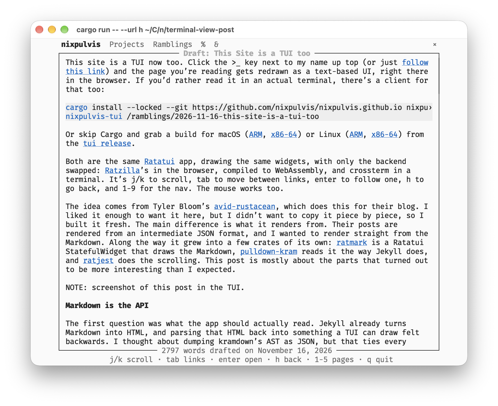

<h2 class="title">This Site is a TUI too</h2>
<p class="meta">
    2730 words
    drafted
    on November 16, 2026
    <span class="comments-controls" hidden>
        <button type="button" class="comments-toggle"></button>
        <button type="button" class="comments-open" hidden>Read comments</button>
    </span>
</p>

This site is now available as a TUI! Click the `>_` key next to my name up top
(or just [follow this link](?tui)) and the page you're reading gets redrawn
inside a text-based UI, right in the browser.

If you'd rather read it in an actual terminal, there's a client for that too.
Download a build from the [`tui` release][tui-release], using `curl` to skip
macOS gatekeeper bullshit.

```sh
# aarch64-apple-darwin, x86_64-apple-darwin,
# aarch64-unknown-linux-gnu, x86_64-unknown-linux-gnu
target=aarch64-apple-darwin
curl -L https://github.com/nixpulvis/nixpulvis.github.io/releases/download/tui/nixpulvis-tui-$target.tar.gz | tar -xz
```

Or build it yourself:

```sh
cargo install --locked --git https://github.com/nixpulvis/nixpulvis.github.io nixpulvis-tui
```

Then run it (as `./nixpulvis-tui` if you just downloaded it outside of your
`$PATH`):

```sh
nixpulvis-tui /ramblings/2026-11-16-this-site-is-a-tui-too
```

Both are the same [Ratatui] app, drawing the same widgets, with basically only
the backend swapped. [Ratzilla] renders the browser with WebAssembly, and
[`crossterm`] renders in the terminal.



The idea comes from Tyler Bloom's [avid-rustacean], which does this for their
blog. I liked it enough to want it here, but rather than copy it piece by
piece, I started fresh. The main difference is what it renders from. Their
posts go through an intermediate JSON format, whereas I wanted to render
straight from the Markdown. Along the way a few crates fell out of it:
[`ratmark`] is a Ratatui `StatefulWidget` that draws the Markdown,
[`pulldown-kram`] reads it the way Jekyll does, and [`ratjest`] handles the
scrolling. This post is mostly about the parts that turned out to be more
interesting than I expected.

## Serving Markdown

Jekyll already turns the site's Markdown into HTML, but parsing that HTML back
into something a TUI can draw would be a lot of extra work, just to recover
what was written in Markdown in the first place. So the site publishes the
Markdown itself. A small Jekyll plugin writes each page's source next to its
HTML, after Liquid has run but before kramdown, so includes and loops are
already filled in. Each page goes through its layouts too (everything but the
outer HTML shell), so the title, date and tags you see in the TUI come from
the same templates as the web page.

The only other piece is `/site.json`, with the nav and an index of pages,
titles, dates and word counts. That's the whole API. It's all static files, so
it caches well, and you can read any of it with plain old `curl`:

```sh
curl https://nixpulvis.com/ramblings/2026-11-16-this-site-is-a-tui-too.md
```

## `ratmark`

[`ratmark`] is what turns that Markdown into Ratatui text. It parses with
[`pulldown-cmark`] and handles the usual CommonMark, plus tables, footnotes,
strikethrough, task lists, definition lists and math. You draw a
`MarkdownView` like any other Ratatui widget. Its `MarkdownState` keeps the
document laid out for the current width, tracks scrolling, and remembers
where every link landed, so focusing or clicking a link still works when it's
wrapped across lines.

The extras are behind feature flags, all off by default. I was tempted to
lump them together as "Jekyll support", but they really are separate things,
and plenty of Markdown only needs one or two of them.

- `front-matter-yaml` and `front-matter-toml` are for the YAML (`---`) or TOML
  (`+++`) block at the top of a document. This isn't a Markdown thing at all,
  it's a static site generator thing. Jekyll reads it for a page's title,
  date, tags and layout. `ratmark` doesn't look for it while rendering, you
  split it off first, hand the body to `ratmark`, and deserialize the front
  matter into your own serde type with [`serde-saphyr`] or [`toml`].

- `html` is for raw HTML, which is part of CommonMark itself, so any Markdown
  might have some. Without this feature the HTML is just left out. With it,
  `ratmark` runs [`html5gum`]'s tokenizer over the tags and keeps whatever
  makes sense in a TUI: text, links, emphasis, lists, tables, `<kbd>` and so
  on. There's no DOM, just a stream of tags, and things like `<script>` or
  `<svg>` are skipped.

- `kramdown` is for Markdown written for kramdown, the dialect Jekyll uses,
  which reads a few things differently than CommonMark. It reads with
  [`pulldown-kram`] (more on that below). A list tagged with `{:toc}` is
  replaced by a table of contents linking to each heading. Markdown inside a
  `markdown="1"` element gets read as Markdown, and attribute lists like
  `{: #intro .note}` are applied to their blocks and spans instead of showing
  up as text. A theme can also style elements by class, so the
  `{:.new-syntax}` after inline code in my [anonymous struct
  post][anon-struct] picks its color from the theme. It goes hand in hand with
  `html`, since kramdown treats the text inside elements like `<kbd>` as HTML.

- `syntax` highlights fenced code blocks with [`syntect`]. It uses
  `syntect`'s pure Rust regex engine, so it still builds for wasm.

- `links` puts each link's URL on the cells it covers, so the backend can
  turn those cells into a real link, clickable in a terminal or an `<a>` in
  the browser ([more on that below](#links)). It's the only feature that needs
  cell extensions, which aren't in a Ratatui release yet ([ratatui#2854]),
  though for now the whole crate builds against the [branch][ratatui-cells]
  that adds them.

- `scroll` makes `MarkdownState` scroll with [`ratjest`], from a wheel, a
  trackpad or a finger. [More on that below](#scrolling) too.

I've tried hard to keep it a general crate. Whenever something on this site
rendered badly, the fix went into the site's markup or the site's app, not
into `ratmark`. A few times I had to revert something that was really just me
teaching the library about my own CSS.

Wide code blocks were a fun one. There's no good way for a TUI to scroll a
single block sideways, so `ratmark` cuts wide lines off with a `‹` or `›`
marker, and each block keeps its own horizontal offset. Swipe or scroll
sideways over a block to move just that one, or use `<` and `>` to move the
topmost wide block on screen. Here's the site's own `Cargo.toml` entry for
`ratmark` to try it on:

```toml
[workspace.dependencies]
ratmark = { git = "https://github.com/nixpulvis/ratmark", default-features = false, features = ["front-matter-yaml", "html", "kramdown", "scroll"] }
```

## `pulldown-kram`

Originally `ratmark` handled kramdown itself, with a growing pile of rewrites
and special cases. But figuring out what kramdown means by a document is
really the parser's job, and none of it has anything to do with drawing a
TUI, so I pulled it out into its own crate, [`pulldown-kram`].

It reads kramdown into ordinary `pulldown-cmark` events, each paired with
whatever attributes an attribute list gives it. The input is lightly rewritten
first, wherever kramdown and CommonMark disagree, then `pulldown-cmark` parses
it, and finally kramdown's extensions (attribute lists, header ids, definition
lists, `$$` math, `markdown="1"` HTML, `{:toc}`, etc.) are added to the
events. Since the output is just `pulldown-cmark` events, existing renderers
keep working, and can use the attributes if they care to. Each extension can
be turned off on its own, and there's also an HTML writer that outputs
elements the same way kramdown does.

The test suite is worth a mention. It runs kramdown's own test cases, plus a
set for each extension, and compares `pulldown-kram`'s HTML against what
kramdown 2.5.2 generates for the same Markdown. Right now 232 of the 364 cases
match, about 64%. That's 158 of kramdown's 216, and 74 of `pulldown-kram`'s
own 148. Cases that don't pass yet are listed in a known failures file, along
with why.

## Links

I wanted links to be real links. Clickable in the terminal, and actual `<a>`
elements in the browser so middle click and "copy link" work like you'd
expect. The problem is that a Ratatui cell is just a symbol and a style, with
nowhere to put a URL.

There's an open proposal for this, [ratatui#2854], with a branch from
WeirdBrains, [`multi-char-cells`][ratatui-cells], that adds extensions to
cells. Its PR ([ratatui#2853]) was closed, but I'm building against the branch
for now. Since `ratmark` depends on it, so does everything else here. With the
`links` feature, `ratmark` puts the URL on each linked cell, the terminal
client writes it out as an OSC 8 hyperlink, and the browser wraps those cells
in `<a>` tags.

That last part needed changes to Ratzilla, so I [forked it][ratzilla-fork] and
added a [`hyperlinks`][rz-hyperlinks] branch. It wraps each run of cells
sharing a link in a single `<a href>` (behind a `hyperlinks` feature), so
hovering shows the URL and screen readers see a link.

## Scrolling

Reading is mostly scrolling, which is exactly where a TUI in the browser feels
the most out of place. A web page follows your fingers on a trackpad pixel by
pixel, and keeps gliding after a flick, while a terminal jumps a whole line at
a time. Getting this to feel right came down to two problems: drawing fast
enough that scrolling doesn't stutter, and turning the pixels a trackpad or
finger moves into whole lines and columns.

### The scroll hitch

The first version scrolled, but on my Mac it was a little choppy. Ratzilla's
DOM backend redrew changed cells through `innerHTML`, so my first fix was to
set the text in place instead ([`dom-text-in-place`][rz-text]). That helped a
lot, and I figured that was the end of it.

Nope. There was still a little hitch every so often, and I spent way too long
looking at my own code before trying it with my browser extensions turned off.
Perfectly smooth. The culprit was my ad blocker, whose content script runs a
`querySelector` on a timer, and the screen was around sixteen thousand
`<span>` elements, one per cell. Every pass walked all of them.

Technically not my bug, but still my problem, since plenty of people run the
same blocker. So two more changes went into the fork. First, each line is now
drawn as runs of cells with the same style, which cuts the number of elements
by about 25x (this is on `dom-text-in-place` too). Second, the backend can now
draw inside any element ([`dom-parent-element`][rz-parent]), so the site
draws inside a shadow root where the rest of the page, ad blockers included,
doesn't see it change at all.

### Scrolling pixels to cells

Turning pixels into cells takes more than dividing by the size of a cell. A
slow swipe should still move, a swipe that's a little diagonal shouldn't move
both ways, and a flick should keep gliding for a bit, slowing down, like a
page does.

This started out in `ratmark` too, but it has nothing to do with Markdown, so
it became its own crate, [`ratjest`]. It takes a host's wheel and touch
events, adds up pixels until there's a whole line or column's worth, and locks
each gesture to one axis. In a terminal, `terminal::Wheel` takes `crossterm`'s
wheel ticks. In the browser, the `web` feature listens for wheel and touch
events on the element the view is drawn in, the same one Ratzilla draws in.

What it scrolls is anything implementing `Scroll`, a trait with a single
method. It gets a step (in whole cells) and the area the widget was drawn in,
scrolls if the step is over that area, and returns whether anything moved. If
nothing did, the gesture ends, which also stops a glide. Ratatui's `ListState`
and `TableState` already implement it, and an app with several widgets can
too, by splitting its area the same way it does when drawing and trying each
part in turn. With the `scroll` feature, `MarkdownState` implements `Scroll`,
moving the page, or the wide code block under the gesture when it goes
sideways.

## Colors

In a terminal, the TUI draws in that terminal's own colors. `ratmark`'s default
themes only use terminal color numbers, like 4 for blue, so the terminal's
palette decides what they look like. The site's app goes a bit further and
mixes the rest of its colors from the terminal's text, background and
16-color palette. The terminal client asks for those with OSC 10, 11 and 4
queries, which work over SSH too.

The site's colors are defined in its stylesheet, and I didn't want a second
copy in Rust that would inevitably drift. So the app reads `css/style.css` at
compile time, with a tiny parser made of `const fn`s that knows just enough
CSS for the site's custom properties: hex colors, `var()`, `light-dark()` and
`color-mix(in oklch, ...)`. The dark palette is the fallback for terminals
that don't answer. The grays (e.g. code block backgrounds and borders) are
written in the CSS as some percentage of the text mixed into the background,
so the app keeps just that percentage, and mixes them in oklch like the
browser does, from whatever text and background it's actually drawn on. If a
color is missing, or written in a way the parser doesn't understand, the build
fails.

In the browser there's no terminal to ask, so the page stands in for one: the
stylesheet gives Ratzilla its palette, as variables like `--ratzilla-color-4`,
set to the site's light or dark colors. Ratzilla doesn't read CSS variables
upstream, so that's another branch in the fork, [`dom-palette`][rz-palette],
which will go back as its own PR. The app reads the same variables by letting
the browser resolve them on a hidden element, and reads them again whenever
the page switches between light and dark.

## Browser

A TUI inside a web page has to give some things back to the browser. Text
selection was the first. Dragging across the screen used to grab the borders
and padding along with the words, so now the page text is the only selectable
area, and copying keeps the blank lines between paragraphs. This is
[`dom-selectable-area`][rz-select] (built on top of `dom-text-in-place`),
which lets whatever's drawing tell the backend where its text is, and
everything else gets `user-select: none`.

History was next, and I have pretty strong opinions about this one. Every link
to another page on the site is a real page load. The browser owns history, the
back button is the browser's back button, and `h` just calls
`history.back()`. I don't like sites that fake navigation with `pushState` and
then try to keep their own idea of history in sync with the browser's. A page
load here is cheap anyway, since the app is cached and the Markdown is small.

Input needed a couple of fixes in Ratzilla's DOM backend too. It replaces its
grid element whenever the window changes size, and the key and mouse listeners
went with it, so input stopped working after a resize. I fixed that on
[`dom-input-after-resize`][rz-input] (`hyperlinks` carries the same fix), but
someone else hit the same bug ([ratzilla#192]) and their fix, [ratzilla#194],
supersedes mine. The other was clicks near the right edge landing a column
off. Clicks were mapped to cells by dividing the grid's width by its columns,
but the grid is as wide as its parent, not its cells.
[`dom-mouse-cell-size`][rz-mouse] uses the measured cell size instead.

Finally, the toggle. I went through a few ideas, like a fake `$ less foo.md`
prompt, a bare glyph in the nav, or making the lambda clickable. Each was
either too cluttered, felt like it was floating, or was just impossible to
find. The framed `>_` key after my name is small, but it looks like something
you can press, and that's really all it needs. The choice sticks between
pages, and a link ending in `?tui` turns it on for whoever follows it.

## What's next

The terminal client gets built for Linux and macOS on every change, and
attached to the [`tui` release][tui-release].

`pulldown-kram` and `ratjest` only depend on released crates, so they can go up
on crates.io first (`pulldown-kram` 0.1.0 is close). `ratmark` will have to
wait until cell extensions ([ratatui#2854]) land in a Ratatui release.

I'm also hoping to get the Ratzilla branches upstream:

- [`hyperlinks`][rz-hyperlinks], linked cells as `<a>` elements
  ([PR][rz-hyperlinks-pr])
- [`dom-input-after-resize`][rz-input], input after a resize, superseded by
  [ratzilla#194], which is open now
- [`dom-mouse-cell-size`][rz-mouse], clicks in the right column
  ([PR][rz-mouse-pr])
- [`dom-text-in-place`][rz-text], fewer elements and DOM updates
  ([PR][rz-text-pr])
- [`dom-parent-element`][rz-parent], drawing in a given element
  ([PR][rz-parent-pr])
- [`dom-selectable-area`][rz-select], selecting just the text
  ([PR][rz-select-pr])
- [`dom-palette`][rz-palette], a palette from CSS variables
  ([PR][rz-palette-pr])

Longer term I've been thinking about replacing Jekyll with a static site
generator written in Rust, documented with rustdoc, where the pages themselves
are modules of the crate. It would start from the same kind of structures as
the app behind the TUI, in the browser and the terminal alike: the site, with
its nav and index, and its pages, with their front matter. But that's a
different post.

[Ratatui]: https://ratatui.rs
[Ratzilla]: https://github.com/ratatui/ratzilla
[`crossterm`]: https://github.com/crossterm-rs/crossterm
[avid-rustacean]: https://github.com/TylerBloom/avid-rustacean
[`ratmark`]: https://github.com/nixpulvis/ratmark
[`pulldown-kram`]: https://github.com/nixpulvis/pulldown-kram
[`ratjest`]: https://github.com/nixpulvis/ratjest
[`pulldown-cmark`]: https://github.com/pulldown-cmark/pulldown-cmark
[`serde-saphyr`]: https://github.com/bourumir-wyngs/serde-saphyr
[`toml`]: https://github.com/toml-rs/toml
[`html5gum`]: https://github.com/untitaker/html5gum
[`syntect`]: https://github.com/trishume/syntect
[anon-struct]: /pr-preview/pr-89/ramblings/2026-10-19-anonymous-struct-parameters
[ratatui#2853]: https://github.com/ratatui/ratatui/pull/2853
[ratatui#2854]: https://github.com/ratatui/ratatui/issues/2854
[ratatui-cells]: https://github.com/WeirdBrains/ratatui/tree/multi-char-cells
[ratzilla-fork]: https://github.com/nixpulvis/ratzilla
[ratzilla#192]: https://github.com/ratatui/ratzilla/issues/192
[ratzilla#194]: https://github.com/ratatui/ratzilla/pull/194
[rz-hyperlinks]: https://github.com/nixpulvis/ratzilla/tree/hyperlinks
[rz-input]: https://github.com/nixpulvis/ratzilla/tree/dom-input-after-resize
[rz-text]: https://github.com/nixpulvis/ratzilla/tree/dom-text-in-place
[rz-parent]: https://github.com/nixpulvis/ratzilla/tree/dom-parent-element
[rz-select]: https://github.com/nixpulvis/ratzilla/tree/dom-selectable-area
[rz-mouse]: https://github.com/nixpulvis/ratzilla/tree/dom-mouse-cell-size
[rz-palette]: https://github.com/nixpulvis/ratzilla/tree/dom-palette

NOTE: fill in the PR links below once they're up.

[rz-hyperlinks-pr]: https://github.com/ratatui/ratzilla/pull/TODO
[rz-mouse-pr]: https://github.com/ratatui/ratzilla/pull/TODO
[rz-text-pr]: https://github.com/ratatui/ratzilla/pull/TODO
[rz-parent-pr]: https://github.com/ratatui/ratzilla/pull/TODO
[rz-select-pr]: https://github.com/ratatui/ratzilla/pull/TODO
[rz-palette-pr]: https://github.com/ratatui/ratzilla/pull/TODO
[tui-release]: https://github.com/nixpulvis/nixpulvis.github.io/releases/tag/tui

